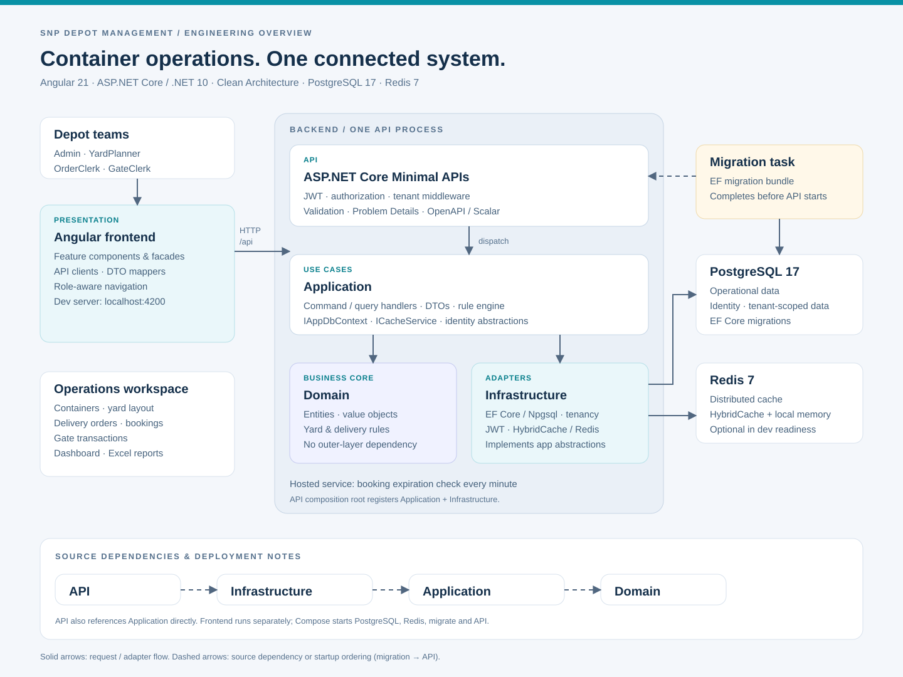

# SNP Depot Management

**Hệ thống quản lý depot container rỗng — từ vận hành cổng đến điều phối bãi.**

SNP Depot Management hỗ trợ quản lý vòng đời container, vị trí lưu bãi, lệnh giao và giữ chỗ trên cùng một nền tảng. Ứng dụng gồm giao diện Angular, API ASP.NET Core và PostgreSQL, với quyền truy cập theo vai trò và phạm vi depot của người dùng.

[Khởi chạy](#khởi-chạy-nhanh) · [Kiến trúc](#kiến-trúc-hệ-thống) · [Kiểm thử](#kiểm-thử-và-build)

## Tổng quan nghiệp vụ

```text
Đăng ký container → Nhập cổng → Phân vị trí / lưu bãi / điều chuyển
                            → Lệnh giao / giữ chỗ → Xuất cổng → Lịch sử & báo cáo
```

| Phân hệ | Khả năng chính |
| --- | --- |
| Tổng quan | Theo dõi tồn bãi, sức chứa, lệnh giao và hoạt động cổng |
| Container | Quản lý hồ sơ, kích thước, chủng loại, tình trạng và lịch sử từng lượt vào/ra |
| Điều phối bãi | Quản lý block vật lý, block ảo, vị trí xếp và điều chuyển container |
| Lệnh giao & giữ chỗ | Quản lý số lượng theo kích thước/chủng loại, gán container và theo dõi tiến độ giao |
| Vận hành cổng | Kiểm tra điều kiện nhập/xuất, ghi nhận, chỉnh sửa và hủy giao dịch theo quy tắc nghiệp vụ |
| Danh mục | Quản lý khách hàng, hãng khai thác, mã chủ sở hữu, phương tiện và chuyến tàu |
| Báo cáo | Tồn bãi, thời gian lưu bãi, lịch sử di chuyển, lệnh sắp hết hạn và xuất Excel |

Các quy tắc nghiệp vụ kiểm tra vị trí, điều kiện xếp chồng, hãng khai thác, hạn lệnh và số lượng trước khi ghi nhận thay đổi. Dịch vụ nền kiểm tra booking hết hạn theo chu kỳ một phút.

## Kiến trúc hệ thống



Backend tổ chức theo **Clean Architecture**, chia ca sử dụng theo feature và tách thao tác đọc/ghi bằng **CQRS nhẹ**. Đây là một backend phân lớp, triển khai trong một tiến trình API; dịch vụ xử lý booking hết hạn chạy trong cùng tiến trình.

| Tầng | Trách nhiệm |
| --- | --- |
| **API** | Minimal API endpoints, validation, JWT, authorization, ánh xạ lỗi Problem Details và lắp ghép dependency injection |
| **Application** | Command/query handlers, DTO, abstraction dữ liệu, cache, identity và tenancy; điều phối ca sử dụng |
| **Domain** | Entity, value object và business rule của container, bãi và lệnh giao |
| **Infrastructure** | EF Core/Npgsql, migrations, seed, JWT, tenant context, HybridCache/Redis và background service |

**Quan hệ phụ thuộc mã nguồn:** Application → Domain; Infrastructure → Application; API tham chiếu Application và Infrastructure để lắp ghép hệ thống. Domain không phụ thuộc các tầng còn lại. Application sử dụng abstraction `IAppDbContext` và các API EF Core; implementation `AppDbContext` nằm trong Infrastructure.

**Luồng xử lý:** Angular gọi HTTP API → endpoint xác thực, phân quyền và kiểm tra đầu vào → handler thực hiện ca sử dụng và quy tắc Domain → các triển khai Infrastructure truy cập PostgreSQL hoặc cache. Tenant được xác định từ danh tính đã xác thực; client không chọn depot bằng header tùy ý.

Frontend tổ chức theo feature, với component hiển thị, facade điều phối trạng thái, API client giao tiếp backend và mapper chuyển DTO sang dữ liệu giao diện. Sơ đồ dùng nét liền cho luồng xử lý/tích hợp và nét đứt cho phụ thuộc mã nguồn hoặc thứ tự khởi động.

## Công nghệ

| Thành phần | Công nghệ |
| --- | --- |
| Frontend | Angular 21, TypeScript 5.9, SCSS, RxJS, Angular CDK |
| Backend | .NET 10, ASP.NET Core Minimal APIs, FluentValidation |
| Dữ liệu | Entity Framework Core, Npgsql, PostgreSQL 17 |
| Cache | HybridCache, Redis 7 |
| Xác thực | JWT Bearer, phân quyền theo vai trò, phạm vi dữ liệu theo depot |
| API documentation | OpenAPI, Scalar trong môi trường Development |
| Kiểm thử | xUnit, NetArchTest, Testcontainers, Vitest, Playwright |
| Triển khai | Docker, Docker Compose; frontend build và phục vụ riêng |

## Vai trò người dùng

| Vai trò | Trách nhiệm chính |
| --- | --- |
| `Admin` | Quản trị tài khoản, danh mục và nghiệp vụ |
| `YardPlanner` | Quy hoạch bãi, phân vị trí và điều chuyển |
| `OrderClerk` | Quản lý lệnh giao và giữ chỗ |
| `GateClerk` | Đăng ký container và xử lý giao dịch cổng |

Quyền cho từng endpoint được định nghĩa trong backend; giao diện hiển thị chức năng theo vai trò đã đăng nhập.

## Khởi chạy nhanh

### Yêu cầu

- Docker Desktop ở chế độ **Linux containers**, Docker Compose v2.
- Node.js **22.12+ trong nhánh 22** và npm **11.5.2** cho frontend.
- .NET SDK **10** khi build/test backend trực tiếp; chạy backend bằng Docker không cần SDK trên máy.

Các lệnh dưới đây dùng **PowerShell tại thư mục gốc repository**, sau khi đã tải mã nguồn.

### 1. Chuẩn bị cấu hình

```powershell
if (-not (Test-Path .env)) { Copy-Item .env.example .env }
```

Mở `.env`, điền mật khẩu và JWT secret. Ví dụ các biến cần chú ý:

```dotenv
POSTGRES_PASSWORD=<mat-khau-database>
JWT_SECRET=<chuoi-ngau-nhien-it-nhat-32-ky-tu>
ADMIN_PASSWORD=<mat-khau-admin>
SEED_DEMO_DATA=true
SEED_USER_PASSWORD=<mat-khau-tai-khoan-demo>
POSTGRES_PORT=5432
REDIS_PORT=6379
API_PORT=5000
```

Thay các placeholder `<...>` bằng giá trị riêng. `SEED_USER_PASSWORD` cần thiết khi bật dữ liệu demo; `.env.example` mặc định tắt demo. Giữ `ADMIN_TENANT_ID` ổn định cho depot. `.env` được Git ignore; thay biến mật khẩu không tự đổi mật khẩu đã lưu trong database.

### 2. Khởi động API và hạ tầng

```powershell
docker compose --env-file .env config --quiet
docker compose --env-file .env up -d --build
docker compose --env-file .env ps -a
```

Compose tạo nhóm `snp-depot` gồm PostgreSQL, Redis, `migrate` và API. Tác vụ `migrate` áp dụng schema trước API, rồi kết thúc với **Exited (0)** khi thành công. API tạo role và tài khoản Admin lúc khởi động. Dữ liệu demo chỉ được seed trong Development khi bật cấu hình tương ứng; khởi động lại không nhân đôi dataset.

### 3. Khởi động frontend

Mở terminal thứ hai tại thư mục gốc:

```powershell
npx.cmd --yes npm@11.5.2 ci --prefix frontend
npm.cmd start --prefix frontend
```

| Địa chỉ mặc định | Mục đích |
| --- | --- |
| http://localhost:4200 | Giao diện ứng dụng |
| http://localhost:5000 | Backend API |
| http://localhost:5000/scalar/v1 | Tài liệu API tương tác, chỉ trong Development |
| http://localhost:5000/health/live | Kiểm tra tiến trình API, không yêu cầu đăng nhập |
| http://localhost:5000/health/ready | Kiểm tra dependency, yêu cầu token Admin |

Frontend chuyển tiếp `/api` tới cổng 5000 qua [proxy configuration](frontend/proxy.conf.json). Nếu đổi `API_PORT`, cập nhật proxy tương ứng. Có thể đổi `POSTGRES_PORT` hoặc `REDIS_PORT` khi cổng trên máy đã được sử dụng.

### 4. Đăng nhập

| Tài khoản | Mật khẩu | Điều kiện |
| --- | --- | --- |
| Giá trị `ADMIN_USERNAME`, mặc định `admin` | `ADMIN_PASSWORD` | Được seed lúc khởi động |
| `yard`, `order`, `gate` | `SEED_USER_PASSWORD` | Bật `SEED_DEMO_DATA=true` trong Development |

Các tài khoản demo tương ứng với vai trò `YardPlanner`, `OrderClerk`, `GateClerk`.

### 5. Dừng và chạy lại

```powershell
docker compose --env-file .env stop
docker compose --env-file .env up -d
```

Dừng frontend bằng `Ctrl+C`. Volume PostgreSQL giữ dữ liệu qua các lần dừng/khởi động; `docker compose down -v` sẽ xóa volume dữ liệu của stack.

## Cấu trúc repository

```text
frontend/                       Angular app, unit tests và Playwright E2E
src/
  Api/                          HTTP endpoints, contracts và authorization
  Application/                  Use cases, handlers, DTO và abstraction
  Domain/                       Entities, value objects và business rules
  Infrastructure/               Persistence, identity, tenancy, cache, background jobs
tests/                         Các bộ kiểm thử backend
  Domain.UnitTests/
  Application.UnitTests/
  Infrastructure.UnitTests/
  Infrastructure.IntegrationTests/
  Api.IntegrationTests/
  Architecture.Tests/
scripts/                        Migration, backup, kiểm tra API và tài liệu
docs/
  images/                       Sơ đồ kiến trúc SVG
Dockerfile                      Build API và migration bundle
docker-compose.yml              Stack phát triển / demo
docker-compose.prod.yml         Stack backend production
.env.example                    Mẫu cấu hình phát triển
.env.prod.example               Mẫu cấu hình production
```

## Kiểm thử và build

### Backend

```powershell
dotnet test SnpDepotManagement.sln
dotnet build SnpDepotManagement.sln --no-restore
```

Integration tests dùng **Testcontainers** tạo PostgreSQL riêng, cần Docker đang chạy. Các bộ unit test kiểm tra nghiệp vụ và handler; architecture tests kiểm tra quy tắc phụ thuộc giữa các tầng.

Nếu Testcontainers trên Windows timeout khi kết nối Docker, cấu hình endpoint trong terminal chạy test:

```powershell
if (-not $env:DOCKER_HOST) {
    $dockerEndpoint = docker context inspect --format '{{.Endpoints.docker.Host}}'
    if ($LASTEXITCODE -ne 0) { throw 'Không đọc được Docker context.' }
    $env:DOCKER_HOST = $dockerEndpoint.Trim() -replace '^npipe:/+\./pipe/', 'npipe://./pipe/'
}
docker version
dotnet test SnpDepotManagement.sln
```

### Frontend

```powershell
npm.cmd test --prefix frontend
npm.cmd run build --prefix frontend
```

Playwright E2E yêu cầu Docker và stack kiểm thử cô lập. Chuẩn bị bằng `pwsh -File scripts/prepare-api-e2e.ps1`, sau đó chạy `npm.cmd run e2e --prefix frontend`.

### Tài liệu và dependency

```powershell
node scripts/check-doc-links.mjs
dotnet list SnpDepotManagement.sln package --vulnerable --include-transitive
```

Lệnh kiểm tra package cần restore trước. Kết quả phụ thuộc dữ liệu vulnerability tại thời điểm chạy.

## Triển khai và vận hành

Production dùng [docker-compose.prod.yml](docker-compose.prod.yml) và [.env.prod.example](.env.prod.example), với tên biến cấu hình riêng so với môi trường phát triển. Stack này triển khai backend và dependency; frontend cần build riêng và cấu hình web server chuyển tiếp `/api` tới backend.

Đặt reverse proxy xử lý TLS trước API, cấu hình origin CORS cụ thể và IP proxy tin cậy nếu sử dụng forwarded headers. Sao lưu database trước khi nâng cấp; dùng các script migration, backup và restore trong `scripts/`. Readiness kiểm tra PostgreSQL và Redis theo chính sách `Redis__Required`; liveness chỉ xác nhận tiến trình đang hoạt động.
