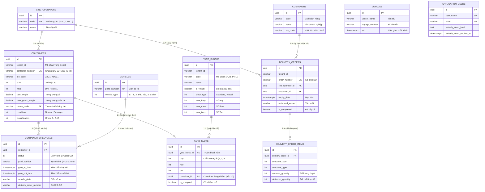

# Thiết Kế Cơ Sở Dữ Liệu Tổng Quát: Tuần 1 (Lớp Domain)

* **Dự án**: Hệ Thống Quản Lý Bãi Container Rỗng (SNP Depot Management)
* **Giai đoạn**: Tuần 1 - Tầng Nghiệp Vụ Cốt Lõi (Domain Layer)
* **Hệ quản trị CSDL**: PostgreSQL (Tương thích chuẩn SQL:2016)
* **Mục tiêu**: Mô hình hóa toàn bộ 11 thực thể của Domain Layer thành lược đồ cơ sở dữ liệu quan hệ (Relational Database Schema) chuẩn hóa bậc 3 (3NF), xác định tường minh Khóa chính (PK), Khóa ngoại (FK), Ràng buộc (Constraints) và Chỉ mục (Indexes).

---

## 1. Sơ Đồ Quan Hệ Thực Thể Tổng Quát (Entity-Relationship Diagram - ERD)



---

## 2. Các Nguyên Tắc Thiết Kế Nền Tảng (Core Design Principles)

### 2.1. Khóa Chính Dùng `UUID` (Surrogate Primary Key)
* **Quy chuẩn**: Toàn bộ bảng đều dùng kiểu dữ liệu `UUID` (`id UUID PRIMARY KEY DEFAULT gen_random_uuid()`).
* **Lý do lựa chọn thay vì `BIGINT Auto-Increment`**:
  1. *Hỗ trợ kiến trúc phân tán & Multi-Depot*: Sinh mã định danh ngẫu nhiên 128-bit, triệt tiêu nguy cơ trùng khóa khi gộp dữ liệu giữa các chi nhánh (Cát Lái, Hiệp Phước, Phú Hữu).
  2. *An toàn bảo mật (Information Hiding)*: Khóa tự tăng làm lộ quy mô kinh doanh qua URL (ví dụ: `api/orders/50` tiết lộ cảng chỉ mới xử lý 50 đơn hàng).
  3. *Tương thích Clean Architecture*: Tầng Domain có thể chủ động tạo mã `Guid.NewGuid()` trước khi ghi xuống DB, giúp đối tượng có ID ngay trong bộ nhớ RAM để gửi Domain Event hoặc làm Unit Test.

### 2.2. Kiểm Toán Dữ Liệu Tự Động (Audit Trail Pattern)
Mọi bảng nghiệp vụ kế thừa từ `AuditableEntity` đều có 4 cột kiểm toán thống nhất:
* `created_at TIMESTAMPTZ NOT NULL DEFAULT CURRENT_TIMESTAMP`: Thời điểm tạo bản ghi.
* `created_by VARCHAR(100) NOT NULL DEFAULT 'SYSTEM'`: Người dùng hoặc tiến trình tạo.
* `last_modified_at TIMESTAMPTZ NULL`: Thời điểm cập nhật lần cuối.
* `last_modified_by VARCHAR(100) NULL`: Người cập nhật lần cuối.

### 2.3. Phân Vùng Đa Chi Nhánh (Multi-Tenancy Isolation)
Các bảng quản lý tài sản và giao dịch tại bãi (`containers`, `yard_blocks`, `delivery_orders`) đều có cột `tenant_id VARCHAR(50) NOT NULL`. Cột này được tích hợp vào các **Composite Unique Indexes** để bảo đảm mỗi Depot quản lý dữ liệu độc lập.

---

## 3. Chi Tiết Danh Sách Bảng, Khóa Chính & Khóa Ngoại

### 3.1. Phân Hệ Dữ Liệu Danh Mục (Master Data)

#### 1. Bảng `line_operators` (Hãng Tàu Sở Hữu Vỏ)
* **Chức năng**: Quản lý danh mục các hãng tàu biển quốc tế lưu giữ vỏ tại depot.
* **Cột dữ liệu**:
  - `id` (`UUID`, **PK**): Khóa chính.
  - `code` (`VARCHAR(10)`, **NOT NULL, UNIQUE**): Mã viết tắt chuẩn quốc tế (ví dụ: `MSC`, `ONE`, `CMA`, `EMC`).
  - `name` (`VARCHAR(200)`, **NOT NULL**): Tên đầy đủ của hãng tàu.
  - 4 cột Audit.

#### 2. Bảng `customers` (Khách Hàng / Chủ Hàng)
* **Chức năng**: Quản lý các công ty logistics, forwarder, chủ hàng đến nhận hoặc hạ vỏ.
* **Cột dữ liệu**:
  - `id` (`UUID`, **PK**).
  - `code` (`VARCHAR(50)`, **NOT NULL**): Mã khách hàng nội bộ.
  - `name` (`VARCHAR(250)`, **NOT NULL**): Tên doanh nghiệp.
  - `tax_code` (`VARCHAR(13)`, **NOT NULL**): Mã số thuế Việt Nam.
    - *Ràng buộc*: `CONSTRAINT chk_tax_code_length CHECK (LENGTH(tax_code) IN (10, 13))`.
  - `address`, `email`, `phone` (`VARCHAR`).
  - 4 cột Audit.

#### 3. Bảng `vehicles` (Phương Tiện Vận Tải)
* **Chức năng**: Quản lý xe kéo, xe tải, sà lan làm thủ tục bốc dỡ qua cổng.
* **Cột dữ liệu**:
  - `id` (`UUID`, **PK**).
  - `plate_number` (`VARCHAR(20)`, **NOT NULL, UNIQUE**): Biển số phương tiện (ví dụ: `51C-12345`).
  - `vehicle_type` (`INT`, **NOT NULL**): 1: Truck, 2: Tractor (Đầu kéo), 3: Barge (Sà lan).
  - 4 cột Audit.

#### 4. Bảng `voyages` (Chuyến Tàu Xuất Nhập)
* **Chức năng**: Quản lý tàu mẹ tiếp nhận container đóng hàng xuất khẩu.
* **Cột dữ liệu**:
  - `id` (`UUID`, **PK**).
  - `vessel_name` (`VARCHAR(100)`, **NOT NULL**): Tên tàu (ví dụ: `MSC OSCAR`).
  - `voyage_number` (`VARCHAR(50)`, **NOT NULL**): Số hiệu chuyến tàu (ví dụ: `2401E`).
  - `etd` (`TIMESTAMPTZ`, **NULL**): Thời gian dự kiến khởi hành (Estimated Time of Departure).
  - 4 cột Audit.

---

### 3.2. Phân Hệ Quản Lý Vỏ Container (Containers)

#### 5. Bảng `containers` (Container Vỏ Rỗng)
* **Chức năng**: Lưu trữ thông tin kỹ thuật, tình trạng hư hỏng và xếp loại vỏ rỗng.
* **Cột dữ liệu**:
  - `id` (`UUID`, **PK**).
  - `tenant_id` (`VARCHAR(50)`, **NOT NULL**): Chi nhánh bãi quản lý.
  - `container_number` (`VARCHAR(11)`, **NOT NULL**): Số cont chuẩn ISO 6346 (11 ký tự).
  - `iso_code` (`VARCHAR(10)`, **NOT NULL**): Mã loại chuẩn (ví dụ: `22G1` cho 20ft khô, `45R1` cho 40ft lạnh).
  - `size` (`INT`, **NOT NULL**): 20 hoặc 40 (feet).
  - `type` (`INT`, **NOT NULL**): 0: Dry, 1: Reefer, 2: OpenTop, 3: FlatRack, 4: Tank.
  - `tare_weight` (`DECIMAL(10,2)`, **NOT NULL**): Trọng lượng bản thân vỏ ($> 0$).
  - `max_gross_weight` (`DECIMAL(10,2)`, **NOT NULL**): Trọng lượng tối đa cho phép.
  - `owner_code` (`VARCHAR(10)`, **NOT NULL**): Mã hãng tàu chủ quản.
  - `condition` (`INT`, **NOT NULL, DEFAULT 0**): 0: Normal, 1: Damaged, 2: UnderRepair.
  - `classification` (`INT`, **NOT NULL, DEFAULT 0**): 0: Grade A, 1: Grade B, 2: Grade C.
  - `date_of_manufacture` (`DATE`, **NULL**): Ngày xuất xưởng.
  - 4 cột Audit.
* **Khóa chính**: `id`.
* **Khóa thay thế (Unique Key)**:
  - `CONSTRAINT uk_tenant_container_number UNIQUE (tenant_id, container_number)`: Mỗi bãi chỉ tồn tại duy nhất 1 vỏ cont có số này.
* **Ràng buộc kiểm tra (Check Constraints)**:
  - `CONSTRAINT chk_container_weights CHECK (tare_weight > 0 AND max_gross_weight > tare_weight)`.

---

### 3.3. Phân Hệ Không Gian Bãi (Yard Stacking)

#### 6. Bảng `yard_blocks` (Phân Khu Bãi Container)
* **Chức năng**: Khối bãi xếp cont vật lý hoặc các khu dịch vụ kỹ thuật ảo.
* **Cột dữ liệu**:
  - `id` (`UUID`, **PK**).
  - `tenant_id` (`VARCHAR(50)`, **NOT NULL**).
  - `code` (`VARCHAR(20)`, **NOT NULL**): Ký hiệu block (ví dụ: `A`, `B`, `PTI-01`, `MR-REPAIR`).
  - `name` (`VARCHAR(100)`, **NOT NULL**): Tên mô tả khu vực.
  - `is_virtual` (`BOOLEAN`, **NOT NULL, DEFAULT FALSE**): Cờ đánh dấu block ảo.
  - `block_type` (`INT`, **NOT NULL**): 0: Standard, 1: Virtual.
  - `max_bays` (`INT`, **NOT NULL, DEFAULT 0**): Số bay tối đa ($X$).
  - `max_rows` (`INT`, **NOT NULL, DEFAULT 0**): Số row tối đa ($Y$).
  - `max_tiers` (`INT`, **NOT NULL, DEFAULT 0**): Số tầng tĩnh không tối đa ($Z$).
  - 4 cột Audit.
* **Khóa thay thế**: `CONSTRAINT uk_tenant_block_code UNIQUE (tenant_id, code)`.

#### 7. Bảng `yard_slots` (Ô Bãi 20ft Bay Lẻ)
* **Chức năng**: Tọa độ vật lý của từng ô chứa container 20ft trong bãi.
* **Cột dữ liệu**:
  - `id` (`UUID`, **PK**).
  - `yard_block_id` (`UUID`, **NOT NULL**): Khóa ngoại trỏ về `yard_blocks(id)`.
  - `bay` (`INT`, **NOT NULL**): Tọa độ chiều dài (bắt buộc số lẻ).
  - `row` (`INT`, **NOT NULL**): Tọa độ chiều rộng ($> 0$).
  - `tier` (`INT`, **NOT NULL**): Tọa độ tầng cao ($> 0$).
  - `container_id` (`UUID`, **NULL**): Khóa ngoại trỏ về `containers(id)` nếu có container đang đặt tại đây.
  - `is_occupied` (`BOOLEAN`, **NOT NULL, DEFAULT FALSE**): `TRUE` nếu ô đã có container.
* **Khóa chính**: `id`.
* **Khóa ngoại (FK)**:
  - `yard_block_id` $\rightarrow$ `yard_blocks(id)`: **`ON DELETE CASCADE`** (Xóa block thì xóa sạch các ô thuộc block).
  - `container_id` $\rightarrow$ `containers(id)`: **`ON DELETE SET NULL`** (Container xuất bãi hoặc di dời thì ô trở về trống).
* **Khóa thay thế (Composite Unique)**:
  - `CONSTRAINT uk_block_bay_row_tier UNIQUE (yard_block_id, bay, row, tier)`: Tuyệt đối không trùng tọa độ.
* **Ràng buộc kiểm tra (Check Constraints)**:
  - `CONSTRAINT chk_odd_bay CHECK (bay % 2 != 0)`: **Quy ước Bay lẻ** — không bao giờ lưu slot bay chẵn.
  - `CONSTRAINT chk_positive_coords CHECK (bay > 0 AND row > 0 AND tier > 0)`.

---

### 3.4. Phân Hệ Tác Nghiệp Cổng Bãi & Vòng Đời (Operations & Lifecycle)

#### 8. Bảng `delivery_orders` (Lệnh Giao Vỏ Rỗng - DO)
* **Chức năng**: Lưu thông tin hạn ngạch giao vỏ được hãng tàu phê duyệt cho chủ hàng.
* **Cột dữ liệu**:
  - `id` (`UUID`, **PK**).
  - `tenant_id` (`VARCHAR(50)`, **NOT NULL**).
  - `order_number` (`VARCHAR(50)`, **NOT NULL**): Số lệnh DO.
  - `line_operator_id` (`UUID`, **NOT NULL**): FK trỏ về `line_operators(id)`.
  - `customer_id` (`UUID`, **NOT NULL**): FK trỏ về `customers(id)`.
  - `expiry_date` (`TIMESTAMPTZ`, **NOT NULL**): Hạn hiệu lực của lệnh.
  - `outbound_vessel` (`VARCHAR(100)`): Tên tàu xuất.
  - `is_completed` (`BOOLEAN`, **NOT NULL, DEFAULT FALSE**): Đã hoàn tất việc cấp vỏ.
  - 4 cột Audit.
* **Khóa ngoại (FK)**:
  - `line_operator_id` $\rightarrow$ `line_operators(id)`: **`ON DELETE RESTRICT`** (Không cho xóa hãng tàu đang có lệnh).
  - `customer_id` $\rightarrow$ `customers(id)`: **`ON DELETE RESTRICT`** (Không cho xóa khách hàng đang có lệnh).
* **Khóa thay thế**: `CONSTRAINT uk_tenant_order_number UNIQUE (tenant_id, order_number)`.

#### 9. Bảng `delivery_order_items` (Chi Tiết Quota Cấp Vỏ Theo Loại)
* **Chức năng**: Quản lý số lượng vỏ được phép lấy theo từng loại kích cỡ.
* **Cột dữ liệu**:
  - `id` (`UUID`, **PK**).
  - `delivery_order_id` (`UUID`, **NOT NULL**): FK trỏ về `delivery_orders(id)`.
  - `container_size` (`INT`, **NOT NULL**): 20 hoặc 40.
  - `container_type` (`INT`, **NOT NULL**): 0: Dry, 1: Reefer...
  - `required_quantity` (`INT`, **NOT NULL**): Hạn ngạch được cấp ($> 0$).
  - `delivered_quantity` (`INT`, **NOT NULL, DEFAULT 0**): Số lượng thực tế đã bốc ra cổng.
* **Khóa ngoại (FK)**:
  - `delivery_order_id` $\rightarrow$ `delivery_orders(id)`: **`ON DELETE CASCADE`** (Xóa lệnh thì xóa các dòng quota).
* **Ràng buộc kiểm tra**:
  - `CONSTRAINT chk_quantities CHECK (required_quantity > 0 AND delivered_quantity >= 0 AND delivered_quantity <= required_quantity)`: Tuyệt đối không cho phép bốc vượt quota.

#### 10. Bảng `container_lifecycles` (Lịch Sử Vòng Đời Lưu Bãi)
* **Chức năng**: Máy trạng thái theo dõi chu trình từ lúc vỏ vào bãi (Gate-In) đến lúc xuất đi (Gate-Out).
* **Cột dữ liệu**:
  - `id` (`UUID`, **PK**).
  - `container_id` (`UUID`, **NOT NULL**): FK trỏ về `containers(id)`.
  - `status` (`INT`, **NOT NULL**): 0: `InYard` (đang nằm trong bãi), 1: `GatedOut` (đã xuất ra cổng).
  - `yard_position` (`VARCHAR(30)`, **NULL**): Tọa độ lưu bãi thực tế (ví dụ: `A-01-02-03`).
  - `gate_in_time` (`TIMESTAMPTZ`, **NOT NULL**): Thời điểm xe hạ vỏ vào bãi.
  - `gate_out_time` (`TIMESTAMPTZ`, **NULL**): Thời điểm xe bốc vỏ ra cổng.
  - `vehicle_plate` (`VARCHAR(20)`, **NULL**): Biển số xe vận chuyển lúc Gate-Out.
  - `delivery_order_number` (`VARCHAR(50)`, **NULL**): Số lệnh DO được áp dụng lúc xuất.
  - 4 cột Audit.
* **Khóa ngoại (FK)**:
  - `container_id` $\rightarrow$ `containers(id)`: **`ON DELETE RESTRICT`** (Không cho xóa container đang có lịch sử vòng đời).

#### 11. Bảng `application_users` (Người Dùng Hệ Thống)
* **Chức năng**: Tài khoản người dùng tác nghiệp (cổng, bãi, giám định, admin).
* **Cột dữ liệu**:
  - `id` (`UUID`, **PK**).
  - `user_name` (`VARCHAR(100)`, **NOT NULL, UNIQUE**).
  - `email` (`VARCHAR(200)`, **NOT NULL, UNIQUE**).
  - `refresh_token_hash` (`TEXT`, **NULL**): Mã băm token phiên đăng nhập.
  - `refresh_token_expires_at` (`TIMESTAMPTZ`, **NULL**).
  - 4 cột Audit.

---

## 4. Giải Thích Logic Xác Định Mối Quan Hệ & Khóa Ngoại

```
┌─────────────────────────────────────────────────────────────────────────────┐
│                           QUY TẮC VÀNG THỰC CHIẾN                          │
│                                                                             │
│  1. Quan hệ 1:N ──> Bên "Nhiều" (Child) LUÔN GIỮ Khóa chính của bên "1"    │
│  2. Quan hệ 1:1 ──> Đặt FK Nullable ở bảng phụ thuộc (có thể có hoặc không) │
│  3. Quan hệ N:N ──> Bắt buộc tạo BẢNG TRUNG GIAN nối 2 Khóa ngoại           │
└─────────────────────────────────────────────────────────────────────────────┘
```

### 4.1. Tại sao `yard_slots` giữ FK `yard_block_id` thay vì ngược lại?
* **Phân tích quan hệ**:
  - Một `YardBlock` có **nhiều** `YardSlot` (hàng trăm ô bãi).
  - Một `YardSlot` chỉ thuộc về duy nhất **một** `YardBlock`.
* **Kết luận**: `yard_slots` là bên "Nhiều", bắt buộc phải giữ cột khóa ngoại `yard_block_id` trỏ về bảng cha `yard_blocks(id)`.

### 4.2. Tại sao `yard_slots.container_id` dùng `ON DELETE SET NULL`?
* Khi container được di dời sang block khác hoặc làm thủ tục Gate-Out xuất khỏi bãi, ô bãi `YardSlot` đó **không bị xóa mất**, nó chỉ đơn giản là trở về trạng thái trống (`container_id = NULL` và `is_occupied = FALSE`). Do đó, hành vi `SET NULL` là chuẩn xác nhất về mặt nghiệp vụ logistics.

### 4.3. Tại sao `delivery_orders` và `delivery_order_items` dùng `ON DELETE CASCADE`?
* Trong Domain-Driven Design (DDD), `DeliveryOrder` là **Aggregate Root**, còn `DeliveryOrderItem` là thực thể con phụ thuộc trọn vẹn vào vòng đời của Root. Dòng quota không thể tồn tại độc lập nếu lệnh giao bị xóa. Do đó, xóa cha sẽ tự động xóa sạch các con (`CASCADE`).

---

## 5. Các Kịch Bản Truy Vấn Thực Tế (SQL Query Scenarios)

### Kịch bản 1: Tìm tất cả container rỗng Grade A thuộc hãng tàu "MSC" đang lưu bãi
```sql
SELECT 
    c.container_number,
    c.size,
    c.type,
    c.classification,
    l.yard_position,
    l.gate_in_time
FROM containers c
JOIN container_lifecycles l ON c.id = l.container_id
WHERE c.owner_code = 'MSC'
  AND c.classification = 0         -- Grade A
  AND c.condition = 0              -- Normal (không hư hỏng)
  AND l.status = 0                 -- InYard (đang trong bãi)
ORDER BY l.gate_in_time ASC;       -- Ưu tiên cấp vỏ vào bãi trước (FIFO)
```

### Kịch bản 2: Tìm các ô bãi còn trống tại tầng 1 (tầng trệt) của Block A để hạ vỏ 20ft
```sql
SELECT 
    s.bay,
    s.row,
    s.tier
FROM yard_slots s
JOIN yard_blocks b ON s.yard_block_id = b.id
WHERE b.code = 'A'
  AND s.tier = 1                   -- Tầng trệt
  AND s.is_occupied = FALSE        -- Ô đang trống
ORDER BY s.bay, s.row;
```

### Kịch bản 3: Kiểm tra lệnh giao DO còn đủ số lượng vỏ 20ft Dry và còn hạn lệnh hay không
```sql
SELECT 
    d.order_number,
    d.expiry_date,
    i.container_size,
    i.container_type,
    i.required_quantity,
    i.delivered_quantity,
    (i.required_quantity - i.delivered_quantity) AS remaining_quantity
FROM delivery_orders d
JOIN delivery_order_items i ON d.id = i.delivery_order_id
WHERE d.order_number = 'DO-2026-001'
  AND d.expiry_date >= CURRENT_TIMESTAMP
  AND i.container_size = 20
  AND i.container_type = 0         -- Dry
  AND (i.required_quantity - i.delivered_quantity) > 0;
```

---

## 6. Mã Nguồn SQL DDL Đầy Đủ (PostgreSQL Production Ready Script)

Dưới đây là toàn bộ mã nguồn SQL hoàn chỉnh có thể sao chép và thực thi trực tiếp trên cơ sở dữ liệu PostgreSQL:

```sql
-- KÍCH HOẠT EXTENSION TẠO UUID NẾU CHƯA CÓ
CREATE EXTENSION IF NOT EXISTS "uuid-ossp";

-- ============================================================================
-- 1. NHÓM BẢNG DANH MỤC DÙNG CHUNG (MASTER DATA)
-- ============================================================================

CREATE TABLE IF NOT EXISTS line_operators (
    id UUID PRIMARY KEY DEFAULT gen_random_uuid(),
    code VARCHAR(10) NOT NULL UNIQUE,
    name VARCHAR(200) NOT NULL,
    created_at TIMESTAMPTZ NOT NULL DEFAULT CURRENT_TIMESTAMP,
    created_by VARCHAR(100) NOT NULL DEFAULT 'SYSTEM',
    last_modified_at TIMESTAMPTZ,
    last_modified_by VARCHAR(100)
);

CREATE TABLE IF NOT EXISTS customers (
    id UUID PRIMARY KEY DEFAULT gen_random_uuid(),
    code VARCHAR(50) NOT NULL,
    name VARCHAR(250) NOT NULL,
    tax_code VARCHAR(13) NOT NULL,
    address VARCHAR(300),
    email VARCHAR(150),
    phone VARCHAR(30),
    created_at TIMESTAMPTZ NOT NULL DEFAULT CURRENT_TIMESTAMP,
    created_by VARCHAR(100) NOT NULL DEFAULT 'SYSTEM',
    last_modified_at TIMESTAMPTZ,
    last_modified_by VARCHAR(100),
    CONSTRAINT chk_tax_code_length CHECK (LENGTH(tax_code) IN (10, 13))
);

CREATE TABLE IF NOT EXISTS vehicles (
    id UUID PRIMARY KEY DEFAULT gen_random_uuid(),
    plate_number VARCHAR(20) NOT NULL UNIQUE,
    vehicle_type INT NOT NULL,
    created_at TIMESTAMPTZ NOT NULL DEFAULT CURRENT_TIMESTAMP,
    created_by VARCHAR(100) NOT NULL DEFAULT 'SYSTEM',
    last_modified_at TIMESTAMPTZ,
    last_modified_by VARCHAR(100)
);

CREATE TABLE IF NOT EXISTS voyages (
    id UUID PRIMARY KEY DEFAULT gen_random_uuid(),
    vessel_name VARCHAR(100) NOT NULL,
    voyage_number VARCHAR(50) NOT NULL,
    etd TIMESTAMPTZ,
    created_at TIMESTAMPTZ NOT NULL DEFAULT CURRENT_TIMESTAMP,
    created_by VARCHAR(100) NOT NULL DEFAULT 'SYSTEM',
    last_modified_at TIMESTAMPTZ,
    last_modified_by VARCHAR(100)
);

-- ============================================================================
-- 2. NHÓM BẢNG QUẢN LÝ CONTAINER
-- ============================================================================

CREATE TABLE IF NOT EXISTS containers (
    id UUID PRIMARY KEY DEFAULT gen_random_uuid(),
    tenant_id VARCHAR(50) NOT NULL DEFAULT '',
    container_number VARCHAR(11) NOT NULL,
    iso_code VARCHAR(10) NOT NULL DEFAULT '',
    size INT NOT NULL,
    type INT NOT NULL,
    tare_weight DECIMAL(10,2) NOT NULL,
    max_gross_weight DECIMAL(10,2) NOT NULL,
    owner_code VARCHAR(10) NOT NULL,
    condition INT NOT NULL DEFAULT 0,
    classification INT NOT NULL DEFAULT 0,
    date_of_manufacture DATE,
    created_at TIMESTAMPTZ NOT NULL DEFAULT CURRENT_TIMESTAMP,
    created_by VARCHAR(100) NOT NULL DEFAULT 'SYSTEM',
    last_modified_at TIMESTAMPTZ,
    last_modified_by VARCHAR(100),
    CONSTRAINT uk_tenant_container_number UNIQUE (tenant_id, container_number),
    CONSTRAINT chk_container_weights CHECK (tare_weight > 0 AND max_gross_weight > tare_weight)
);

-- ============================================================================
-- 3. NHÓM BẢNG KHÔNG GIAN BÃI CONTAINER
-- ============================================================================

CREATE TABLE IF NOT EXISTS yard_blocks (
    id UUID PRIMARY KEY DEFAULT gen_random_uuid(),
    tenant_id VARCHAR(50) NOT NULL DEFAULT '',
    code VARCHAR(20) NOT NULL,
    name VARCHAR(100) NOT NULL,
    is_virtual BOOLEAN NOT NULL DEFAULT FALSE,
    block_type INT NOT NULL,
    max_bays INT NOT NULL DEFAULT 0,
    max_rows INT NOT NULL DEFAULT 0,
    max_tiers INT NOT NULL DEFAULT 0,
    created_at TIMESTAMPTZ NOT NULL DEFAULT CURRENT_TIMESTAMP,
    created_by VARCHAR(100) NOT NULL DEFAULT 'SYSTEM',
    last_modified_at TIMESTAMPTZ,
    last_modified_by VARCHAR(100),
    CONSTRAINT uk_tenant_block_code UNIQUE (tenant_id, code)
);

CREATE TABLE IF NOT EXISTS yard_slots (
    id UUID PRIMARY KEY DEFAULT gen_random_uuid(),
    yard_block_id UUID NOT NULL REFERENCES yard_blocks(id) ON DELETE CASCADE,
    bay INT NOT NULL,
    row INT NOT NULL,
    tier INT NOT NULL,
    container_id UUID REFERENCES containers(id) ON DELETE SET NULL,
    is_occupied BOOLEAN NOT NULL DEFAULT FALSE,
    CONSTRAINT uk_block_bay_row_tier UNIQUE (yard_block_id, bay, row, tier),
    CONSTRAINT chk_odd_bay CHECK (bay % 2 != 0),
    CONSTRAINT chk_positive_coords CHECK (bay > 0 AND row > 0 AND tier > 0)
);

-- ============================================================================
-- 4. NHÓM BẢNG TÁC NGHIỆP CỔNG BÃI & VÒNG ĐỜI
-- ============================================================================

CREATE TABLE IF NOT EXISTS delivery_orders (
    id UUID PRIMARY KEY DEFAULT gen_random_uuid(),
    tenant_id VARCHAR(50) NOT NULL DEFAULT '',
    order_number VARCHAR(50) NOT NULL,
    line_operator_id UUID NOT NULL REFERENCES line_operators(id) ON DELETE RESTRICT,
    customer_id UUID NOT NULL REFERENCES customers(id) ON DELETE RESTRICT,
    expiry_date TIMESTAMPTZ NOT NULL,
    outbound_vessel VARCHAR(100),
    is_completed BOOLEAN NOT NULL DEFAULT FALSE,
    created_at TIMESTAMPTZ NOT NULL DEFAULT CURRENT_TIMESTAMP,
    created_by VARCHAR(100) NOT NULL DEFAULT 'SYSTEM',
    last_modified_at TIMESTAMPTZ,
    last_modified_by VARCHAR(100),
    CONSTRAINT uk_tenant_order_number UNIQUE (tenant_id, order_number)
);

CREATE TABLE IF NOT EXISTS delivery_order_items (
    id UUID PRIMARY KEY DEFAULT gen_random_uuid(),
    delivery_order_id UUID NOT NULL REFERENCES delivery_orders(id) ON DELETE CASCADE,
    container_size INT NOT NULL,
    container_type INT NOT NULL,
    required_quantity INT NOT NULL,
    delivered_quantity INT NOT NULL DEFAULT 0,
    CONSTRAINT chk_valid_quantities CHECK (required_quantity > 0 AND delivered_quantity >= 0 AND delivered_quantity <= required_quantity)
);

CREATE TABLE IF NOT EXISTS container_lifecycles (
    id UUID PRIMARY KEY DEFAULT gen_random_uuid(),
    container_id UUID NOT NULL REFERENCES containers(id) ON DELETE RESTRICT,
    status INT NOT NULL,
    yard_position VARCHAR(30),
    gate_in_time TIMESTAMPTZ NOT NULL DEFAULT CURRENT_TIMESTAMP,
    gate_out_time TIMESTAMPTZ,
    vehicle_plate VARCHAR(20),
    delivery_order_number VARCHAR(50),
    created_at TIMESTAMPTZ NOT NULL DEFAULT CURRENT_TIMESTAMP,
    created_by VARCHAR(100) NOT NULL DEFAULT 'SYSTEM',
    last_modified_at TIMESTAMPTZ,
    last_modified_by VARCHAR(100)
);

-- ============================================================================
-- 5. NHÓM BẢNG NGƯỜI DÙNG TÁC NGHIỆP
-- ============================================================================

CREATE TABLE IF NOT EXISTS application_users (
    id UUID PRIMARY KEY DEFAULT gen_random_uuid(),
    user_name VARCHAR(100) NOT NULL UNIQUE,
    email VARCHAR(200) NOT NULL UNIQUE,
    refresh_token_hash TEXT,
    refresh_token_expires_at TIMESTAMPTZ,
    created_at TIMESTAMPTZ NOT NULL DEFAULT CURRENT_TIMESTAMP,
    created_by VARCHAR(100) NOT NULL DEFAULT 'SYSTEM',
    last_modified_at TIMESTAMPTZ,
    last_modified_by VARCHAR(100)
);

-- ============================================================================
-- 6. CHỈ MỤC TỐI ƯU HIỆU NĂNG TRUY VẤN (INDEXES)
-- ============================================================================

CREATE INDEX IF NOT EXISTS idx_containers_tenant ON containers(tenant_id);
CREATE INDEX IF NOT EXISTS idx_containers_owner ON containers(owner_code);
CREATE INDEX IF NOT EXISTS idx_yard_slots_occupancy ON yard_slots(yard_block_id, is_occupied);
CREATE INDEX IF NOT EXISTS idx_lifecycles_container ON container_lifecycles(container_id, status);
CREATE INDEX IF NOT EXISTS idx_delivery_orders_lookup ON delivery_orders(tenant_id, order_number, is_completed);
```
