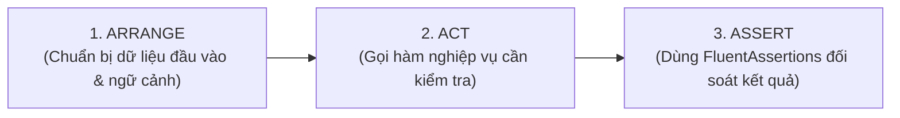

# Giải Thích Chi Tiết Toàn Bộ Bài Test Tuần 1 (Domain Layer)

* **Dự án**: Hệ Thống Quản Lý Bãi Container Rỗng (SNP Depot Management)
* **Giai đoạn**: Tuần 1 - Tầng Nghiệp Vụ Cốt Lõi (Domain Layer)
* **Bộ công cụ kiểm thử**: .NET 10, xUnit, FluentAssertions, NetArchTest.Rules
* **Kết quả thực tế**: **121 / 121 Tests Passed** (120 Domain Unit Tests + 1 Architecture Test) | Thời gian chạy: $\approx 0.3$ giây

---

## 1. Tổng Quan Về Kiến Trúc Kiểm Thử

Toàn bộ 121 bài test trong Tuần 1 được xây dựng theo phương pháp **Test-Driven Development (TDD)** và tuân thủ chặt chẽ mô hình **AAA (Arrange - Act - Assert)**:



* **Zero Shared State**: Mỗi test method chạy trên một instance class test hoàn toàn mới, không phụ thuộc cơ sở dữ liệu, không ghi đè dữ liệu lên nhau, chạy hoàn toàn trên bộ nhớ RAM.
* **Quy chuẩn đặt tên test**: `TenHam_DieuKienDauVao_KetQuaKyVong()` (ví dụ: `IsBroken_WhenDispatchDateAfterExpiryDate_ShouldBeTrue()`).

---

## 2. Giải Thích Chi Tiết Các Bài Test Theo Từng Ngày

---

### NGÀY 1: Nền Tảng Result Pattern, Error & Business Rule Validator

Mục tiêu kiểm thử của Ngày 1 là bảo đảm cơ chế chuyển luồng không dùng Exception và bộ duyệt quy tắc nghiệp vụ hoạt động chính xác.

#### 1. Bài test luồng Thành công (`Result.Success`)
```csharp
[Fact]
public void Result_Success_ShouldHaveIsSuccessTrue_AndNoError()
{
    // Arrange & Act: Tạo kết quả thành công
    var result = Result.Success();

    // Assert: Xác nhận cờ trạng thái và không có lỗi
    result.IsSuccess.Should().BeTrue();
    result.IsFailure.Should().BeFalse();
    result.Error.Should().Be(Error.None);
}
```
* **Ý nghĩa nghiệp vụ**: Đảm bảo khi một thao tác nghiệp vụ thành công, hệ thống gán `IsSuccess = true` và xóa sạch mã lỗi.

#### 2. Bài test luồng Thất bại mang mã lỗi cố định (`Result.Failure`)
```csharp
[Fact]
public void Result_Failure_ShouldContainSpecifiedError()
{
    // Arrange: Khởi tạo mã lỗi chuẩn
    var expectedError = Error.Validation("Input.Invalid", "Dữ liệu không đúng quy chuẩn.");

    // Act
    var result = Result.Failure(expectedError);

    // Assert
    result.IsSuccess.Should().BeFalse();
    result.IsFailure.Should().BeTrue();
    result.Error.Code.Should().Be("Input.Invalid");
}
```
* **Ý nghĩa nghiệp vụ**: Khi thất bại, `Result` phải mang đúng `Code` để Frontend/Mobile có thể bắt mã lỗi hiển thị thông báo đa ngôn ngữ (i18n).

#### 3. Bài test ném ngoại lệ khi vi phạm quy tắc (`BusinessRuleValidator.Check`)
```csharp
[Fact]
public void BusinessRuleValidator_WhenRuleIsBroken_ShouldThrowBusinessRuleException()
{
    // Arrange: Mock một rule có IsBroken() == true
    var brokenRule = new MockBrokenRule();

    // Act: Đóng gói hành vi trong Action delegate
    Action act = () => BusinessRuleValidator.Check(brokenRule);

    // Assert: Kỳ vọng ném ra BusinessRuleException
    act.Should().Throw<BusinessRuleException>()
       .Which.Rule.Should().Be(brokenRule);
}
```
* **Ý nghĩa nghiệp vụ**: Đảm bảo bộ điều phối tự động ngắt luồng và ném ngoại lệ chuẩn hóa HTTP 422 ngay khi phát hiện vi phạm quy tắc bãi.

---

### NGÀY 2: Container (Chuẩn ISO 6346), Master Data & ApplicationUser (55 Tests)

Ngày 2 tập trung vào thẩm định thuật toán quốc tế Modulo 11 và bất biến trọng lượng.

#### 1. Bài test số container chuẩn quốc tế hợp lệ (`ContainerNumberTests`)
```csharp
[Fact]
public void Create_WithValidNumber_ShouldSucceed()
{
    // Arrange: Số cont chuẩn ISO của hãng tàu CSQ
    var validNumber = "CSQU3054383";

    // Act
    var result = ContainerNumber.Create(validNumber);

    // Assert: Kiểm tra từng thành phần cấu tạo
    result.IsSuccess.Should().BeTrue();
    result.Value!.Value.Should().Be(validNumber);
    result.Value.OwnerCode.Should().Be("CSQ");           // 3 ký tự đầu
    result.Value.CategoryIdentifier.Should().Be('U');    // Ký tự phân loại
    result.Value.SerialNumber.Should().Be("305438");     // 6 số serial
    result.Value.CheckDigit.Should().Be(3);              // Số kiểm tra tính bằng Modulo 11
}
```
* **Ý nghĩa nghiệp vụ**: Đảm bảo Value Object `ContainerNumber` bóc tách chính xác từng trường thông tin theo chuẩn vận tải biển quốc tế.

#### 2. Bài test tự động chuẩn hóa chữ thường và khoảng trắng
```csharp
[Theory]
[InlineData("csqu3054383")]
[InlineData(" CSQU 305438 3 ")]
[InlineData("csqu 305438 3")]
public void Create_WithLowerCaseOrWhitespace_ShouldNormalizeSuccessfully(string input)
{
    // Act
    var result = ContainerNumber.Create(input);

    // Assert: Tự động xóa khoảng trắng và in hoa
    result.IsSuccess.Should().BeTrue();
    result.Value!.Value.Should().Be("CSQU3054383");
}
```
* **Ý nghĩa nghiệp vụ**: Giúp phần mềm thân thiện với người dùng thực tế: tài xế gõ chữ thường hoặc gõ thừa dấu cách ở cổng thì hệ thống tự làm sạch, không báo lỗi phiền hà.

#### 3. Bài test số kiểm tra không khớp (Modulo 11 Mismatch)
```csharp
[Fact]
public void Create_WhenCheckDigitMismatch_ShouldReturnCheckDigitMismatchError()
{
    // Arrange: Số đúng là 3 nhưng cố tình gõ số 9
    var input = "CSQU3054389";

    // Act
    var result = ContainerNumber.Create(input);

    // Assert
    result.IsFailure.Should().BeTrue();
    result.Error.Code.Should().Be("ContainerNumber.CheckDigitMismatch");
}
```
* **Ý nghĩa nghiệp vụ**: Chặn đứng việc gõ nhầm số container khi làm thủ tục vào cổng, ngăn chặn rủi ro thất lạc tài sản hàng triệu USD.

#### 4. Bài test tự động hạ cấp chất lượng khi báo hỏng vỏ (`MarkDamaged`)
```csharp
[Fact]
public void MarkDamaged_ShouldSetConditionToDamaged_AndDowngradeToGradeC()
{
    // Arrange: Khởi tạo container loại A (đóng hàng thực phẩm)
    var container = Container.Create(validContainerNumber, "22G1", ContainerSize.Ft20, 
        ContainerType.Dry, tareWeight: 2200, maxGrossWeight: 30480, null, "MSC").Value!;
    container.Classification.Should().Be(Classification.A);

    // Act: Giám định viên phát hiện rách thủng vách
    container.MarkDamaged("Thủng vách bên phải");

    // Assert
    container.Condition.Should().Be(ContainerCondition.Damaged);
    container.Classification.Should().Be(Classification.C); // Tự động hạ về C
}
```
* **Ý nghĩa nghiệp vụ**: Vỏ bị rách thì hệ thống tự động khóa không cho cấp cho các đơn hàng đóng gạo, cà phê hoặc điện tử đòi hỏi Grade A.

#### 5. Bài test xác thực Mã Số Thuế khách hàng Việt Nam (`CustomerTests`)
```csharp
[Theory]
[InlineData("0301446260")]       // MST 10 chữ số (Doanh nghiệp độc lập)
[InlineData("0301446260-001")]   // MST 13 ký tự chuẩn chi nhánh
public void Create_WithValidTaxCode_ShouldSucceed(string taxCode)
{
    var result = Customer.Create("CUST-01", "Tân Cảng Logistics", taxCode);
    result.IsSuccess.Should().BeTrue();
}

[Theory]
[InlineData("12345")]            // Quá ngắn
[InlineData("0301446260ABC")]    // Chứa chữ cái
public void Create_WithInvalidTaxCode_ShouldFail(string taxCode)
{
    var result = Customer.Create("CUST-01", "Tân Cảng Logistics", taxCode);
    result.IsFailure.Should().BeTrue();
    result.Error.Code.Should().Be("Customer.InvalidTaxCode");
}
```
* **Ý nghĩa nghiệp vụ**: Tuân thủ nghiêm ngặt quy định hóa đơn điện tử và đăng ký kinh doanh của Bộ Tài Chính Việt Nam.

---

### NGÀY 3: Không Gian Bãi (Yard Block, Slot, Expand & Shrink) (14 Tests)

Ngày 3 kiểm thử quy ước hình học bãi container và thuật toán phát hiện xung đột nguyên tử.

#### 1. Bài test quy ước Bay lẻ (Odd-Bay Convention)
```csharp
[Fact]
public void CreateStandard_ShouldGenerateSlotsOnlyForOddBays()
{
    // Arrange: Khởi tạo block có 5 bays, 4 rows, 3 tiers
    // Bay lẻ: 1, 3, 5 (3 bays) => 3 * 4 * 3 = 36 slots
    var block = YardBlock.CreateStandard("BLOCK-A", "Standard Block A", bays: 5, rows: 4, tiers: 3);

    // Assert: Khẳng định 100% slot sinh ra chỉ nằm ở bay lẻ
    block.Slots.Should().HaveCount(36);
    block.Slots.All(s => s.Bay % 2 != 0).Should().BeTrue("YardSlot chỉ được phép tồn tại ở bay lẻ");
}
```
* **Ý nghĩa nghiệp vụ**: Database không lưu các ô bay chẵn để tránh dư thừa và xung đột không gian khi xếp container 40ft.

#### 2. Bài test mở rộng quy mô bãi (`Expand`)
```csharp
[Fact]
public void Expand_ShouldIncreaseDimensionsAndGenerateNewSlots()
{
    // Arrange: Block ban đầu có 3 bays (bay 1, 3) => 8 slots
    var block = YardBlock.CreateStandard("BLOCK-A", "Block A", bays: 3, rows: 2, tiers: 2);

    // Act: Mở rộng lên 5 bays
    var result = block.Expand(newMaxBays: 5, newMaxRows: 2, newMaxTiers: 2);

    // Assert: Tăng lên 12 slots, giữ nguyên các ô cũ và sinh thêm ô ở bay 5
    result.IsSuccess.Should().BeTrue();
    block.MaxBays.Should().Be(5);
    block.Slots.Should().HaveCount(12);
    block.Slots.Should().Contain(s => s.Bay == 5 && s.Row == 1 && s.Tier == 1);
}
```
* **Ý nghĩa nghiệp vụ**: Khi cảng cơi nới mặt bằng bãi, hệ thống tự động sinh thêm ô chứa mà không làm ảnh hưởng đến các container đang nằm ở vị trí cũ.

#### 3. Bài test Conflict Detection chặn thu hẹp bãi khi có container (`Shrink`)
```csharp
[Fact]
public void Shrink_WhenSlotOccupied_ShouldReturnConflict()
{
    // Arrange: Block 5 bays. Chiếm 1 ô tại bay 5
    var block = YardBlock.CreateStandard("BLOCK-A", "Block A", bays: 5, rows: 2, tiers: 2);
    block.OccupySlot(bay: 5, row: 1, tier: 1, Guid.NewGuid()).IsSuccess.Should().BeTrue();

    // Act: Cố tình thu hẹp block về 3 bays (cắt bỏ bay 5)
    var result = block.Shrink(newMaxBays: 3, newMaxRows: 2, newMaxTiers: 2);

    // Assert: Thao tác bị chặn đứng nguyên tử
    result.IsFailure.Should().BeTrue();
    result.Error.Code.Should().Be("YardBlock.ShrinkConflictWithOccupiedSlots");
    block.MaxBays.Should().Be(5); // Vẫn giữ nguyên 5 bays
    block.Slots.Should().HaveCount(12);
}
```
* **Ý nghĩa nghiệp vụ**: Chống thất lạc tài sản: Nghiêm cấm xóa phân khu bãi nếu trên thực địa vẫn còn container đang nằm trong khu vực giải tỏa.

---

### NGÀY 4: Bốn Quy Tắc An Toàn Xếp Bãi (Yard Rules - TDD) (29 Tests)

Ngày 4 kiểm thử các định luật vật lý và an toàn tĩnh không khi xếp chồng container rỗng cao tầng.

#### 1. Bài test chặn container 40ft tại mép ngoài cùng của block (`ValidBayContainerSizeRuleTests`)
```csharp
[Fact]
public void IsBroken_When40FtAtEdgeWhereAdjacentBayExceedsBlock_ShouldBeTrue()
{
    // Arrange: Block có 4 bays. Đặt cont 40ft vào bay 4 (chẵn)
    // Nửa sau cont rơi vào: bay + 1 = 5 > 4 (thò ra ngoài bãi!)
    var rule = new ValidBayContainerSizeRule(bay: 4, ContainerSize.Ft40, maxBays: 4);

    // Act & Assert: Vi phạm an toàn mép bãi
    rule.IsBroken().Should().BeTrue();
    rule.Error.Code.Should().Be("YardRule.InvalidBayForSize");
}
```
* **Ý nghĩa nghiệp vụ**: Ngăn cản xe nâng hạ container 40ft thò đầu ra ngoài đường nội bộ bãi, phòng tránh tai nạn va quẹt xe đầu kéo.

#### 2. Bài test động lực học hai chân đỡ cho container 40ft (`SlotBelowMustBeOccupiedRuleTests`)
```csharp
[Fact]
public void IsBroken_When40FtOnTier2_AndOnlyOneSupportingSlotOccupied_ShouldBeTrue()
{
    // Arrange: Block có bay 1 và bay 3 ở tầng 1.
    // Chỉ có bay 1 có container đỡ, bay 3 đang TRỐNG!
    var block = YardBlock.CreateStandard("BLOCK-A", "Block A", bays: 4, rows: 2, tiers: 3);
    block.OccupySlot(bay: 1, row: 1, tier: 1, Guid.NewGuid());

    // Act: Cố gắng đặt cont 40ft vào bay 2 tầng 2 (bắc ngang qua bay 1 và 3)
    var rule = new SlotBelowMustBeOccupiedRule(block, bay: 2, row: 1, tier: 2, ContainerSize.Ft40);

    // Assert: Thiếu chân đỡ bên phải => Vi phạm quy tắc, không cho phép đặt
    rule.IsBroken().Should().BeTrue();
    rule.Error.Code.Should().Be("YardRule.SlotBelowMustBeOccupied");
}
```
* **Ý nghĩa nghiệp vụ**: Container 40ft dài 12m, nếu chỉ đỡ một đầu thì đầu kia sẽ bị võng và gãy sập toàn bộ khối container khi có gió bão.

#### 3. Bài test tầng trệt luôn hợp lệ
```csharp
[Fact]
public void IsBroken_WhenTier1_ShouldAlwaysBeFalse()
{
    var block = YardBlock.CreateStandard("BLOCK-A", "Block A", bays: 4, rows: 2, tiers: 3);
    var rule = new SlotBelowMustBeOccupiedRule(block, bay: 1, row: 1, tier: 1, ContainerSize.Ft20);

    // Assert: Đặt trên nền đất thì không bao giờ vi phạm
    rule.IsBroken().Should().BeFalse();
}
```

---

### NGÀY 5: Lệnh Giao Vỏ (DO), Vòng Đời & Architecture Test (23 Tests)

Ngày 5 kiểm thử luồng cấp vỏ ra cổng và kiểm tra ranh giới Clean Architecture.

#### 1. Bài test trừ quota nguyên tử trong `DeliveryOrderItem`
```csharp
[Fact]
public void Allocate_ShouldDecreaseRemainingQuantity()
{
    // Arrange: Lệnh giao duyệt 5 container 20ft Dry
    var order = DeliveryOrder.Create("DO-01", "MSC", "0123456789", "CTY A", DateTime.UtcNow.AddDays(5), "VESSEL-01").Value!;
    order.AddItem(ContainerSize.Ft20, ContainerType.Dry, quantity: 5);
    var item = order.Items.First();

    // Act: Xe vào bốc 2 container
    var result = item.Allocate(2);

    // Assert: Đã cấp 2, quota còn lại chính xác là 3
    result.IsSuccess.Should().BeTrue();
    item.DeliveredQuantity.Should().Be(2);
    item.RemainingQuantity.Should().Be(3);
}
```
* **Ý nghĩa nghiệp vụ**: Đảm bảo số lượng còn lại (`RemainingQuantity`) luôn được trừ dần chính xác theo thời gian thực.

#### 2. Bài test chặn cấp vượt quota cho phép
```csharp
[Fact]
public void Allocate_WhenExceedingRemainingQuantity_ShouldReturnError()
{
    // Arrange: Lệnh chỉ còn lại 5 container
    var order = DeliveryOrder.Create("DO-01", "MSC", "0123456789", "CTY A", DateTime.UtcNow.AddDays(5), "VESSEL-01").Value!;
    order.AddItem(ContainerSize.Ft20, ContainerType.Dry, quantity: 5);
    var item = order.Items.First();

    // Act: Cố tình yêu cầu cấp 6 container
    var result = item.Allocate(6);

    // Assert: Bị từ chối ngay lập tức
    result.IsFailure.Should().BeTrue();
    result.Error.Code.Should().Be("DeliveryOrderItem.QuantityExceeded");
    item.DeliveredQuantity.Should().Be(0); // Không bị trừ nhầm
}
```
* **Ý nghĩa nghiệp vụ**: Ngăn chặn tài xế hoặc nhân viên cổng thông đồng bốc vỏ vượt quá số lượng hãng tàu cho phép.

#### 3. Bài test kiểm tra hạn hiệu lực lệnh giao vỏ (`DeliveryOrderNotExpiredRuleTests`)
```csharp
private readonly DateTime _expiryDate = new(2026, 10, 10, 23, 59, 59, DateTimeKind.Utc);

[Fact]
public void IsBroken_WhenDispatchDateBeforeExpiryDate_ShouldBeFalse()
{
    // Đúng hạn (ngày 8/10 < hạn 10/10) => Hợp lệ
    var dispatchDate = new DateTime(2026, 10, 8, 10, 0, 0, DateTimeKind.Utc);
    var rule = new DeliveryOrderNotExpiredRule(_expiryDate, dispatchDate);

    rule.IsBroken().Should().BeFalse();
}

[Fact]
public void IsBroken_WhenDispatchDateOnSameDayAsExpiryDate_ShouldBeFalse()
{
    // Đúng ngày cuối cùng (vẫn tính hợp lệ đến hết 23:59:59 của ngày 10/10)
    var dispatchDate = new DateTime(2026, 10, 10, 15, 0, 0, DateTimeKind.Utc);
    var rule = new DeliveryOrderNotExpiredRule(_expiryDate, dispatchDate);

    rule.IsBroken().Should().BeFalse();
}

[Fact]
public void IsBroken_WhenDispatchDateAfterExpiryDate_ShouldBeTrue()
{
    // Quá hạn (ngày 11/10 > hạn 10/10) => Vi phạm, từ chối cấp vỏ
    var dispatchDate = new DateTime(2026, 10, 11, 8, 0, 0, DateTimeKind.Utc);
    var rule = new DeliveryOrderNotExpiredRule(_expiryDate, dispatchDate);

    rule.IsBroken().Should().BeTrue();
    rule.Error.Code.Should().Be("OrderRule.DeliveryOrderExpired");
}
```
* **Ý nghĩa nghiệp vụ**: Bảo đảm đối soát chính xác theo ngày: khách hàng có quyền lấy vỏ đến hết ngày cuối cùng của lệnh; nếu quá hạn 1 ngày cũng bị từ chối để tránh phát sinh cước lưu bãi tranh chấp với hãng tàu.

#### 4. Bài test chặn quét xuất cổng 2 lần trên cùng một container (`ContainerLifecycleTests`)
```csharp
[Fact]
public void GateOut_WhenAlreadyGatedOut_ShouldReturnConflict()
{
    // Arrange: Container vào bãi rồi xuất bãi thành công
    var lifecycle = ContainerLifecycle.GateIn(Guid.NewGuid(), "A-01-01-01", DateTime.UtcNow.AddHours(-2)).Value!;
    lifecycle.GateOut(DateTime.UtcNow.AddHours(-1), "51C-12345", "DO-01").IsSuccess.Should().BeTrue();

    // Act: Cố tình quét thẻ xuất lần thứ 2
    var result = lifecycle.GateOut(DateTime.UtcNow, "51C-99999", "DO-02");

    // Assert: Trả về lỗi xung đột trạng thái
    result.IsFailure.Should().BeTrue();
    result.Error.Code.Should().Be("ContainerLifecycle.AlreadyGatedOut");
}
```
* **Ý nghĩa nghiệp vụ**: Chặn đứng lỗ hổng gian lận dùng 1 container xuất bãi 2 lần để tráo đổi tài sản.

#### 5. Bài test bảo vệ kiến trúc Clean Architecture (`Architecture.Tests`)
```csharp
[Fact]
public void Domain_ShouldNotHaveDependenciesOnOtherProjects()
{
    var domainAssembly = typeof(BaseEntity).Assembly;

    // Quét binary assembly: Domain không được phụ thuộc vào Application hoặc Infrastructure
    var result = Types.InAssembly(domainAssembly)
        .ShouldNot()
        .HaveDependencyOnAny("SnpDepotManagement.Application", "SnpDepotManagement.Infrastructure")
        .GetResult();

    result.IsSuccessful.Should().BeTrue();
}
```
* **Ý nghĩa kỹ thuật**: Bảo vệ tầng Domain hoàn toàn độc lập, không bị rò rỉ mã hạ tầng hoặc SQL.

---

### NGÀY 6: Rà Soát Tính Toàn Vẹn & Kiểm Thử Hồi Quy (Regression Tests)

Ngày 6 dùng toàn bộ bộ test làm **hàng rào kiểm thử hồi quy**:

#### 1. Bài test kiểm tra bất biến đóng gói của tập hợp Slots
```csharp
[Fact]
public void YardBlock_Slots_ShouldBeReadOnly_CannotBeDirectlyModified()
{
    var block = YardBlock.CreateStandard("BLOCK-A", "Block A", bays: 3, rows: 2, tiers: 2);

    // Cố tình ép kiểu sang IList để Add phần tử từ bên ngoài
    Action act = () => ((IList<YardSlot>)block.Slots).Add(null!);

    // Bắt buộc phải ném NotSupportedException
    act.Should().Throw<NotSupportedException>();
}
```
* **Ý nghĩa kỹ thuật**: Khẳng định biến `_slots` được che giấu tuyệt đối sau `IReadOnlyCollection`, không ai có thể can thiệp phá vỡ tính toàn vẹn của Aggregate Root.

---

### NGÀY 7: Tự Động Hóa Kiểm Thử & Chạy Báo Cáo Trên Terminal

Ngày 7 chuẩn hóa việc chạy test qua giao diện dòng lệnh (CLI).

#### Lệnh chạy toàn bộ 121 bài test:
```powershell
dotnet test SnpDepotManagement.sln
```

#### Kết quả thực thi thực tế:
```text
Test run for ...\tests\Domain.UnitTests\bin\Debug\net10.0\SnpDepotManagement.Domain.UnitTests.dll (.NETCoreApp,Version=v10.0)
Passed!  - Failed: 0, Passed: 120, Skipped: 0, Total: 120, Duration: 114 ms

Test run for ...\tests\Architecture.Tests\bin\Debug\net10.0\SnpDepotManagement.Architecture.Tests.dll (.NETCoreApp,Version=v10.0)
Passed!  - Failed: 0, Passed:   1, Skipped: 0, Total:   1, Duration: 169 ms

========================================================================================================================
TỔNG KẾT: 121 PASSED / 0 FAILED / 0 SKIPPED (100% SUCCESS) | TỔNG THỜI GIAN: ~0.3 GIÂY
```

---

## 3. Bảng Ma Trận Tổng Hợp Mã Lỗi Đã Được Phủ Kín Bằng Unit Test

| Mã Lỗi Domain (Error Code) | Tên Bài Test Tương Ứng | Kết Quả Kỳ Vọng |
|---|---|---|
| `ContainerNumber.Empty` | `Create_WhenEmptyOrWhitespace_ShouldReturnEmptyError` | Trả về lỗi khi chuỗi rỗng/chỉ có dấu cách |
| `ContainerNumber.InvalidLength` | `Create_WhenLengthInvalid_ShouldReturnInvalidLengthError` | Trả về lỗi khi độ dài khác 11 ký tự |
| `ContainerNumber.CheckDigitMismatch` | `Create_WhenCheckDigitMismatch_ShouldReturnCheckDigitMismatchError` | Trả về lỗi khi số kiểm tra sai theo Modulo 11 |
| `Container.InvalidTareWeight` | `Create_WhenTareWeightZeroOrNegative_ShouldReturnError` | Trả về lỗi khi TareWeight $\le 0$ |
| `Container.InvalidMaxGrossWeight`| `Create_WhenMaxGrossWeightLessThanOrEqualToTareWeight_ShouldReturnError` | Trả về lỗi khi MaxGross $\le$ TareWeight |
| `YardBlock.ShrinkConflictWithOccupiedSlots` | `Shrink_WhenSlotOccupied_ShouldReturnConflict` | Chặn thu hẹp bãi khi có ô đang bị chiếm |
| `YardRule.InvalidBayForSize` | `IsBroken_When40FtAtEdgeWhereAdjacentBayExceedsBlock_ShouldBeTrue` | Chặn container 40ft ở mép ngoài bãi |
| `YardRule.SlotBelowMustBeOccupied` | `IsBroken_When40FtOnTier2_AndOnlyOneSupportingSlotOccupied_ShouldBeTrue` | Chặn container 40ft thiếu 1 trong 2 chân đỡ |
| `DeliveryOrderItem.QuantityExceeded` | `Allocate_WhenExceedingRemainingQuantity_ShouldReturnError` | Chặn bốc vượt hạn ngạch cấp vỏ |
| `ContainerLifecycle.AlreadyGatedOut` | `GateOut_WhenAlreadyGatedOut_ShouldReturnConflict` | Chặn quét xuất bãi lần thứ hai |
| `OrderRule.DeliveryOrderExpired` | `IsBroken_WhenDispatchDateAfterExpiryDate_ShouldBeTrue` | Chặn xuất vỏ khi lệnh đã quá hạn |
